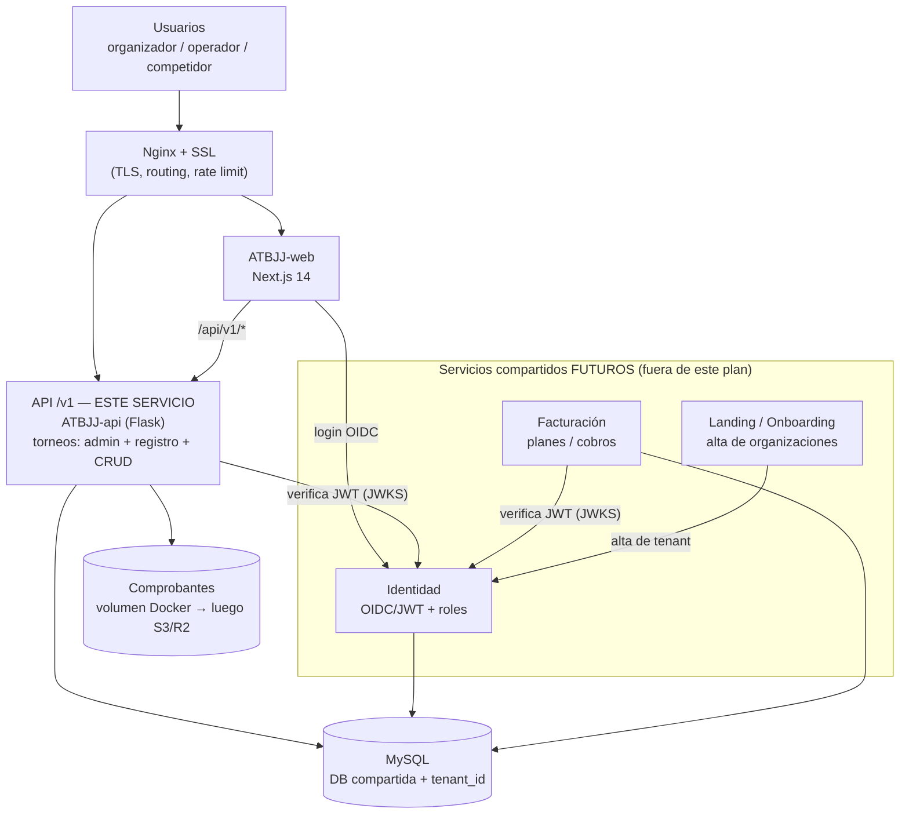

# Plan de migración a SaaS — Aztlan 2026

> Servicio "Torneos" (pantalla de administración + registro de competidores/alumnos + CRUD)
> dentro de una futura cadena de microservicios SaaS multi-organización.
>
> Repos analizados: `ATBJJ` (Next 14) y `ATBJJ-api` (Flask 3).
> Equipo: 2 desarrolladores. Infra actual: 1 VPS (Nginx + PM2 + Gunicorn) y MySQL.
>
> **Nomenclatura:** los repos de GitHub se renombraron a `ATBJJ` / `ATBJJ-api`; los slugs antiguos siguen redirigiendo. Los dominios del producto (`torneoaztlan.com` / `.cloud`) y las rutas del VPS no cambian.
>
> **Versión publicada en el repositorio:** los datos de infraestructura (host/IP del VPS y rutas internas) fueron sustituidos por marcadores como `<HOST_VPS>`. La versión completa, con los valores reales, se mantiene fuera de GitHub.

---

## 0. Respuesta rápida

**¿Es viable migrar esto a SaaS ahora? Sí, pero primero hay que cerrar agujeros de seguridad y no reescribir.**

El valor de negocio (registro + admin + CRUD de torneos) ya funciona y es reutilizable; no hace falta reescribir. Lo que impide venderlo hoy no es la falta de features, es que el servicio está pensado para un solo torneo (campo `torneo` como string, configuración hardcodeada) y, sobre todo, que **no tiene autorización real**: hay endpoints de listado que se sirven sin credenciales, `CORS` es `*` y el login del admin solo protege la pantalla, no los datos. Con 2 personas, la ruta correcta es incremental (patrón *strangler fig*): asegurar, luego aislar por tenant, luego homogeneizar y preparar el terreno para identidad/facturación.

**Los 3 mayores riesgos:**

1. **Fuga de datos entre organizaciones** (el más grave). Aislamiento solo en código; MySQL no tiene Row-Level Security nativa como Postgres, así que un `WHERE` olvidado expone a todos los tenants.
2. **Romper producción durante la migración de datos**. Hay datos reales de torneos anteriores y no existe Alembic ni backups automatizados. *Mitigado hoy: no hay torneo activo, así que la migración de esquema puede hacerse en una sola pasada.*
3. **Dispersión del contrato API**. Los tipos del front están escritos a mano y ya pueden divergir; al sumar microservicios el problema se multiplica.

---

## 1. Diagnóstico del estado actual

### 1.1 Lo que ya sirve (no tocar, reutilizar)

| Área | Evidencia | Veredicto |
|---|---|---|
| Registro público (3 flujos) | `app/registro/{juvenil,adultos,masters}/page.tsx` + `RegistroForm.tsx` | Reutilizable tal cual |
| Admin dashboard | `app/admin/page.tsx`, `useUsers.ts`, `components/admin/*` | Reutilizable, falta paginación |
| Lista final + reglamento | `app/lista-final`, `app/lib/listaFinal.ts`, `app/reglamento` | Reutilizable |
| Asistencias por equipo/sucursal | `app/[equipo]/[sucursal]/asistencias` + `routes/asistencias.py` | Reutilizable |
| API Flask estructurada | `routes/`, `services/`, `schemas/` (pydantic), `utils/` | Buena base; ya usa capas |
| Swagger/OpenAPI | `flasgger` en `/apidocs/` y `/apispec.json` | Base para el contrato |
| Cliente HTTP único | `app/lib/api.ts` | Punto único para inyectar auth/tenant |
| Deploy con rollback | `update-front.sh` (guarda commit previo, healthcheck) | Concepto bueno; migrar a CI/CD |
| Generación de IDs | `utils/aztlan_id.py` (`azt+3`) | Reutilizable (revisar unicidad por tenant) |

### 1.2 Lo que bloquea el SaaS

| Bloqueo | Dónde | Por qué bloquea |
|---|---|---|
| **Sin autorización en la API** | `app.py`, `routes/usuarios.py` | El listado de competidores se sirve sin token ni rol |
| **Admin protegido solo en el cliente** | `app/admin/page.tsx` (modal) + `app/admin/auth/route.ts` | No hay `middleware.ts`; `/admin` se sirve a cualquiera y los datos se pueden pedir directo |
| **CORS `*`** | `app.py` L29 | Cualquier sitio puede llamar a la API |
| **Un solo torneo hardcodeado** | `config.CURRENT_TOURNAMENT="2026-b"`, `ADMIN_TOURNAMENT` en `admin/page.tsx`, `TORNEO_ACTUAL` en `listaFinal.ts` | No hay `tournament_id`; filtrar por string |
| **Config de features hardcodeada** | `app/lib/registroConfig.ts` (`REGISTRO_ABIERTO`, `LISTA_FINAL_PUBLICA`) | Requiere redeploy para abrir/cerrar registro |
| **Modelo acoplado** | `models/registro.py` (comprobante embebido en `registros`) | Mezcla competidor con su pago |
| **Sin migraciones** | `db.create_all()` en `app.py` L27 | No evoluciona el esquema sin perder datos |
| **Sin multitenancy** | Todo el esquema | No hay `organizations` ni `tenant_id` |
| **Tipos duplicados a mano** | `app/lib/api.ts` | Divergen del backend |
| **Sin tests** | Ambos repos | Refactor sin red de seguridad |
| **`venv` versionado en la API** | Repo `ATBJJ-api` (el `venv/` está en disco pese a figurar en `.gitignore`, se commiteó antes) | Fuerza el hack `git checkout origin/main -- <rutas>` en el VPS |
| **Sin staging** | Solo `torneoaztlan.cloud` | No hay forma de probar sin arriesgar producción |
| **Secretos en `.env` del server** | `.env.production`, `.env` API | Sin gestión centralizada |

### 1.3 Lo que sobra (limpiar)

- `venv/` y `__pycache__/` en el repo de la API (sacar del control de versiones).
- `.env.production` con `NEXT_PUBLIC_API_URL=/api` (correcto) pero la API sigue **expuesta directo en `<HOST_VPS>:5000`** (`api.ts` L7): cerrar ese puerto.
- Dato muerto: `_password` escapado por si la contraseña tiene símbolos, pero el default es `""`.
- Bandera `DB_USE_MOCK` en `env.example` que ya no corresponde al código (no se implementa).

---

## 2. Arquitectura objetivo

### 2.1 Diagrama de la cadena de microservicios



**Rol de este servicio:** es el **servicio de torneos**. Expone `/api/v1` para: registrar competidores/alumnos, listar y gestionar (CRUD) participantes, aprobar comprobantes, asistencia por QR y servir la configuración de un torneo. **No** hace login ni cobros: consume el servicio de identidad y, más adelante, la facturación.

**Comunicación:**
- Cliente → servicios: **HTTPS + JWT** (Bearer). El tenant viaja como *claim* verificado en el token, nunca como header de confianza.
- Servicio → servicio: **tokens máquina-a-máquina** (client credentials OAuth2) o *token exchange* (RFC 8693) cuando haga falta actuar en nombre de un usuario.
- Todos los servicios comparten **MySQL** con aislamiento por `tenant_id` (§3) y validan tokens contra el mismo JWKS del servicio de identidad.

### 2.2 Multi-tenancy en Next.js (resolución del tenant)

| Estrategia | URL | Cuándo usar |
|---|---|---|
| Path | `app.com/org/acme/...` | Ya es la forma actual (`/[equipo]/[sucursal]`) → **más simple, empezar aquí** |
| Subdominio | `acme.app.com` | Cuando se venda con marca propia |
| Dominio custom | `app.acme.com` | Tier premium (postergar) |

**Recomendación:** hoy el tenant se resuelve **por path + claim del JWT**. Añadir un `middleware.ts` en Next que lea el `Host`/path y valide contra la sesión. Migrar a subdominio (`acme.torneoaztlan.cloud`) en la fase 5, cuando haya >1 cliente real.

---

## 3. Modelo de multi-tenancy recomendado

### 3.1 Decisión: **Shared database, shared schema + `tenant_id`** (una sola DB, una sola copia de tablas)

**Por qué:** con 2 devs, pocos tenants (< 100), MySQL y un VPS pequeño, es la única opción con costo operativo bajo y migraciones centralizadas. *Schema por tenant* o *DB por tenant* multiplican migraciones, backups y despliegues por cada cliente.

**El riesgo real** de shared schema es que el aislamiento depende del código. Se mitiga con el patrón **obligatorio** de la OWASP Multi-Tenant Cheat Sheet: filtrar en la capa de sesión, no a mano en cada query. MySQL no tiene RLS nativa (a diferencia de Postgres), así que la única defensa sólida es la aplicación.

> Ruta de graduación: si un cliente exige aislamiento físico por contrato, se migra **solo ese tenant** a su propia DB (patrón híbrido) sin tocar el resto.

### 3.2 Esquema de tablas propuesto

| Tabla | Cambio | Campos clave |
|---|---|---|
| `organizations` (tenant) | **nueva** | `id`, `slug` UNIQUE, `nombre`, `plan`, `estado`, `created_at` |
| `tournaments` | **nueva** | `id`, `organization_id` FK, `codigo` (antes string `"2026-b"`), `nombre`, `registro_abierto` BOOL, `lista_final_publica` BOOL, `reglamento_url`, `config` JSON, UNIQUE(`organization_id`,`codigo`) |
| `admin_users` | **nueva** | `id`, `organization_id` (NULL para superadmin), `email` UNIQUE, `rol` ENUM(`superadmin`,`organizador`,`operador`), `identity_sub` (id externo del servicio de identidad) |
| `registros` (competidores/alumnos) | **modificar** | + `organization_id` FK NOT NULL, + `tournament_id` FK NOT NULL; quitar `torneo` string; `aztlan_id` pasa a UNIQUE(`organization_id`,`aztlan_id`) |
| `comprobantes` | **nueva (separar)** | `id`, `registro_id` FK, `organization_id`, `storage_key`, `filename`, `media_type`, `size_bytes`, `aprobado` BOOL, `aprobado_por`, `aprobado_at` |
| `asistencias` | **modificar** | + `organization_id` FK, + `tournament_id` FK |

> **Nota de nombres:** el endpoint actual `GET /usuarios` en realidad devuelve **competidores**, no usuarios de administración. En `/api/v1` renombrar a `GET /v1/participants` (o `/competidores`) para no confundir con `admin_users`.

### 3.3 Reglas de aislamiento obligatorias

1. **Toda tabla con datos de tenant lleva `organization_id` NOT NULL + índice**, y los índices compuestos empiezan por `organization_id` (p. ej. `(organization_id, created_at)`).
2. **Filtrar en la sesión, no a mano.** Usar `TenantAwareSession` con `do_orm_execute` + `with_loader_criteria` (patrón OWASP) para que el filtro se aplique a SELECTs, cargas eager y lazy. *Fail closed*: si no hay tenant en contexto, lanzar excepción, nunca devolver query sin filtro.
3. **Estampar en escritura.** En `before_flush`, asignar `tenant_id` a los objetos nuevos y rechazar si traen otro tenant.
4. **El tenant del cliente es solo un selector.** Verificar que el `sub` autenticado pertenece a ese tenant (tabla de membresía/`admin_users`); no confiar en headers.
5. **Claves foráneas reales** con `ON DELETE` explícito (`organizations`→`tournaments`→`registros`→`comprobantes`); hoy `registros` no declara FK en `asistencias.registro_id` con comportamiento definido.
6. **Constraints únicos por tenant**: `UNIQUE(organization_id, aztlan_id)`, `UNIQUE(organization_id, codigo)`, `UNIQUE(organization_id, email)` donde aplique.
7. **Test de aislamiento negativo obligatorio en CI**: sembrar datos de la org A y B y afirmar que A no puede leer/PATCH/DELETE los de B (cubre BOLA/IDOR, OWASP API1:2023 y API3:2023).

Ejemplo mínimo del mixin/sesión tenant-aware (ilustrativo, patrón OWASP):

```python
from sqlalchemy import Column, String, event
from sqlalchemy.orm import Session, declared_attr, with_loader_criteria

class TenantMixin:
    @declared_attr
    def organization_id(cls):
        return Column(String(36), nullable=False, index=True)

class TenantAwareSession(Session):
    def __init__(self, *a, tenant_id=None, **kw):
        super().__init__(*a, **kw)
        self._tenant_id = tenant_id

    @property
    def tenant_id(self):
        if not self._tenant_id:
            raise SecurityException("Tenant context required")  # fail closed
        return self._tenant_id

@event.listens_for(TenantAwareSession, "do_orm_execute")
def _filter(execute_state):
    if execute_state.is_select and not execute_state.is_column_load \
       and not execute_state.is_relationship_load:
        tid = execute_state.session.tenant_id
        execute_state.statement = execute_state.statement.options(
            with_loader_criteria(TenantMixin,
                                 lambda m: m.organization_id == tid,
                                 include_aliases=True))
```

---

## 4. Estrategia de repositorios

### 4.1 Recomendación: **polyrepo (varios repos)**, no monorepo

| Opción | Pros | Contras | Veredicto |
|---|---|---|---|
| **Polyrepo** (actual) | Deploy independiente por servicio; encaja con microservicios; permisos separados | Riesgo de deriva de contrato; más PRs cruzados | **Elegida** |
| Monorepo | Un solo PR cambia front+back+contrato; sin deriva | Acopla deploys; exige tooling (Nx/Turborepo); sobredimensionado para 2 devs | Fallback si el coste de coordinación duele |

Con 2 personas y una dirección de microservicios, el polyrepo + un **paquete de contratos versionado** resuelve la deriva sin acoplar despliegues.

### 4.2 Repos finales

| Repo | Contenido | Deploy |
|---|---|---|
| `ATBJJ-web` | Frontend Next.js (este servicio) | PM2 → luego Docker |
| `ATBJJ-api` | API Flask de torneos + **sus migraciones Alembic** | Gunicorn → luego Docker |
| `ATBJJ-contracts` | `openapi.yaml` (fuente de verdad) + tipos TS generados + esquemas | npm/paquete versionado |
| `ATBJJ-infra` | `docker-compose*.yml`, `nginx/`, plantillas de GitHub Actions, scripts, `.env.example` | N/A (config) |
| *(futuro)* `ATBJJ-identity` | Servicio de identidad | — |
| *(futuro)* `ATBJJ-billing` | Facturación | — |

> **Sobre `ATBJJ-db`:** **no** recomiendo un repo separado que "posea" las migraciones. En microservicios cada servicio **es dueño de su esquema** y sus migraciones viven junto al código (`ATBJJ-api/migrations/`). Un repo `db` central acopla servicios justo cuando queremos desacoplarlos. Si se necesita un lugar para *baselines SQL, seeds y backups*, que sea parte de `ATBJJ-infra`, no la fuente de migraciones.

### 4.3 Convención de nombres y ramas

- Repos: `ATBJJ-<componente>` (kebab-case).
- Ramas: `main` (producción), `staging` (pre-prod), `feature/ABC-123-descripcion`, `fix/...`, `chore/...`. Tags de release: `web-v1.3.0`, `api-v1.3.0`, `contracts-v1.1.0`.
- PRs siempre contra `staging`; `staging`→`main` con aprobación manual.
- Commits: Conventional Commits (`feat:`, `fix:`, `chore:`, `refactor:`).
- Contrato: `contracts` se publica con SemVer; el `minor` se sube al **agregar** endpoints/campos (compatible) y `major` al romperlos.

---

## 5. Homogenización del servicio

### 5.1 Estructura de carpetas de la API

```
ATBJJ-api/
  app/
    __init__.py          # create_app()
    config.py            # pydantic-settings por entorno
    extensions.py        # db, migrate, cors, limiter, jwt
    tenant.py            # TenantAwareSession + middleware de contexto
    models/              # organizacion.py, torneo.py, registro.py, ...
    schemas/             # pydantic (entrada/salida)
    routes/v1/           # registro.py, participants.py, tournaments.py, comprobantes.py, asistencias.py
    services/
    utils/
  migrations/            # Alembic (reemplaza db.create_all)
  tests/                 # conftest.py, test_tenant_isolation.py, ...
  .env.example
  Makefile
  pyproject.toml         # ruff + black + pytest
```

### 5.2 Convenciones transversales

| Tema | Decisión |
|---|---|
| Versionado API | **`/api/v1`** en el path (ej. nginx: `proxy_pass http://api/v1/`). Mantener alias legacy `/registro`→`/v1/registro` durante 1 release |
| Formato de errores | `{ "error": { "code": "tenant_forbidden", "message": "...", "details": [] } }` + HTTP status correcto |
| Paginación | `?limit=50&cursor=<opaco>` → `{ data: [...], meta: { total, next_cursor } }` |
| Validación | Backend: `pydantic` (ya en uso). Frontend: `zod` + parseo de respuestas del cliente generado |
| Migraciones | **Flask-Migrate/Alembic**. Regla de oro: agregar columna **nullable** → backfill en migración de datos → luego `NOT NULL`; nunca `NOT NULL` sin default sobre tabla con filas |
| Tests | API: `pytest` + `Flask-Testing` + SQLite/MySQL efímero. Web: `Vitest` (unidad) + `Playwright` (E2E de registro y login) |
| Linters | API: `ruff` + `black`. Web: `eslint` + `prettier` |
| Tareas | `Makefile` en cada repo: `make lint`, `make test`, `make migrate`, `make run` |
| Env | `.env.example` versionado en cada repo; `.env` nunca |
| Logs | JSON estructurado con `tenant_id`, `request_id`, `user_id` |

### 5.3 De configuración hardcodeada → configuración por tenant

| Hoy | Objetivo |
|---|---|
| `REGISTRO_ABIERTO = true` (`registroConfig.ts`) | `tournaments.registro_abierto` (por torneo) |
| `LISTA_FINAL_PUBLICA = false` | `tournaments.lista_final_publica` |
| `CURRENT_TOURNAMENT = "2026-b"` (`config.py`) | `tournament_id` del token/ruta |
| `ADMIN_TOURNAMENT = "2026-b"` (`admin/page.tsx`) | idem, derivado de la sesión |
| `ATTENDANCE_CLASSES` (env CSV) | tabla `attendance_classes` por organización |
| `GMAIL_*` / `ADMIN_EMAIL` (env) | tabla `organizations.config` + variables de plataforma |
| Reglamento / textos | `tournaments.reglamento_url` y `config` JSON |
| Plan/cupo de features | tabla `entitlements` (ver §10) |

**Mecánica:** el front deja de leer constantes y pide `GET /v1/tournaments/{id}/config` (cacheable); el backend resuelve todo desde DB por tenant. Coste: una migración inicial con los valores actuales sembrados (org Aztlan, torneo `2026-b`, `registro_abierto=true`, `lista_final_publica=false`).

---

## 6. Plan de migración de datos

**Ventana actual: no hay torneo activo**, así que la migración se ejecuta en una sola pasada y sin presión de tráfico. Eso no elimina el respaldo: hay datos reales de torneos anteriores.

Regla: primero expandir (agregar), luego migrar/backfill, y **solo al final** contraer (quitar columnas), en un release posterior.

### 6.1 Orden de pasos

| # | Paso | Tipo |
|---|---|---|
| 0 | `mysqldump` completo + copia offsite. Instalar Alembic y generar baseline del esquema actual | Prep |
| 1 | Migración: crear `organizations`, `tournaments`, `admin_users` | Expand |
| 2 | Sembrar: org `aztlan` (slug `aztlan`), torneo `2026-b`, superadmin | Seed |
| 3 | Migración: agregar `organization_id` y `tournament_id` **nullable** a `registros` y `asistencias` | Expand |
| 4 | Backfill (migración de datos): `registros.organization_id = <org aztlan>`, `registros.tournament_id = (SELECT id FROM tournaments WHERE codigo = registros.torneo)` | Backfill |
| 5 | Verificar: 0 filas con `tenant_id IS NULL`; conteos coinciden | Verificación |
| 6 | Migración: `ALTER ... MODIFY organization_id NOT NULL` + FKs + índices + UNIQUE(`organization_id`,`aztlan_id`) | Contract |
| 7 | Deploy del código que ya escribe/lee el modelo nuevo (mantener `torneo` string en paralelo) | Deploy |
| 8 | (Release siguiente) crear `comprobantes`, copiar las columnas embebidas, cambiar la lectura, luego **eliminar** las columnas viejas de `registros` y la columna `torneo` | Contract |

Ejemplo de la migración 3→4 (ilustrativo):

```sql
-- Paso 3 (expand, seguro en producción)
ALTER TABLE registros
  ADD COLUMN organization_id CHAR(36) NULL,
  ADD COLUMN tournament_id   CHAR(36) NULL,
  ADD INDEX idx_registros_org_created (organization_id, created_at);

-- Paso 4 (backfill)
UPDATE registros r
  JOIN tournaments t ON t.codigo = r.torneo
  SET r.organization_id = t.organization_id,
      r.tournament_id   = t.id
WHERE r.organization_id IS NULL;

-- Paso 6 (contract, solo tras verificar 0 NULLs)
ALTER TABLE registros
  MODIFY organization_id CHAR(36) NOT NULL,
  MODIFY tournament_id   CHAR(36) NOT NULL,
  ADD CONSTRAINT fk_reg_org  FOREIGN KEY (organization_id) REFERENCES organizations(id),
  ADD CONSTRAINT fk_reg_tour FOREIGN KEY (tournament_id)   REFERENCES tournaments(id),
  ADD UNIQUE KEY uq_reg_org_aztlan (organization_id, aztlan_id);
```

### 6.2 Criterios de verificación

- `SELECT COUNT(*) FROM registros WHERE organization_id IS NULL` = 0.
- Cada `tournaments.codigo` mapea exactamente a una org; ningún `registro.torneo` quedó sin torneo.
- Conteo `registros` antes = después (mismo número de filas).
- Test de aislamiento negativo pasa en CI.
- Smoke test E2E en staging: registrar, subir comprobante, aprobar, ver lista final.

### 6.3 Rollback

- Migraciones nº 3 y 4 son aditivas → rollback = `DROP` de las columnas nuevas, sin pérdida.
- El código nuevo se despliega con **feature flag** (`USE_TENANT_MODEL`) que le permite leer del esquema viejo. Apagar la flag = rollback instantáneo sin tocar datos.
- La migración nº 6 (NOT NULL/FK) solo se ejecuta cuando el código ya está estable 100% en el modelo nuevo; antes de eso se puede revertir sin datos perdidos.
- Backup del paso 0 permite restaurar; se documenta el tiempo de `restore` medido antes del corte.

---

## 7. Infraestructura objetivo

### 7.1 Decisión: migrar a **Docker Compose** (con Nginx en el host)

| Opción | Pros | Contras | Veredicto |
|---|---|---|---|
| Mantener PM2 + Gunicorn | Ya funciona; cero migración | Rompe *parity* staging/prod; el bug del `venv` versionado; "funciona en mi máquina" | Solo hasta Fase 2 |
| **Docker Compose** | Mismo compose para staging y prod (parity); resuelve el `venv`; reinicio = `docker compose up -d --build`; volúmenes para MySQL y uploads | Curva inicial; +RAM en el VPS | **Elegida** |

Con 2 personas, la ganancia está en que **staging y prod usan el mismo `docker-compose.yml`** cambiando solo el `.env` y el nombre de proyecto. Eso elimina la causa del hack de `venv`.

### 7.2 Cómo conviven hoy y cómo quedan

| Componente | Hoy | Objetivo |
|---|---|---|
| Nginx + SSL (Certbot) | Host | **Se queda en el host** (gestiona Certbot y routing); proxy a contenedores |
| Frontend Next | PM2 `react-ui-app` :3000 | Contenedor `web` (o PM2 hasta Fase 2) |
| Backend Flask | Gunicorn :5000, **expuesto en `<HOST_VPS>:5000`** | Contenedor `api`; **cerrar el puerto público**, solo Nginx lo alcanza |
| MySQL | Host | Contenedor `db` con **volumen nombrado** + backup `mysqldump` a offsite |
| Uploads (comprobantes) | Carpeta en el host | Volumen Docker `uploads`; luego S3-compatible (Cloudflare R2 / Backblaze / MinIO) |
| Correo (Gmail SMTP) | Env | Igual, pero **desactivado en staging** (`EMAIL_ENABLED=false`) |
| Certificados | Certbot en host | Sin cambios |

### 7.3 Estructura de carpetas en el VPS

```
/srv/aztlan/
  prod/
    docker-compose.yml          # override de prod
    .env                        # NO versionado
    nginx/aztlan.conf
  staging/
    docker-compose.yml          # mismo archivo base, project name distinto
    .env
    nginx/aztlan-staging.conf
  backups/mysql/                # mysqldump diario (rotación 7d)
```

`docker-compose.yml` base (ilustrativo, acotado):

```yaml
services:
  db:
    image: mysql:8.0
    environment:
      MYSQL_DATABASE: ${DB_NAME}
      MYSQL_USER: ${DB_USER}
      MYSQL_PASSWORD: ${DB_PASSWORD}
      MYSQL_ROOT_PASSWORD: ${DB_ROOT_PASSWORD}
    volumes: ["db_data:/var/lib/mysql"]
    healthcheck:
      test: ["CMD", "mysqladmin", "ping", "-h", "localhost"]
      interval: 10s
  api:
    build: ../ATBJJ-api
    env_file: .env
    depends_on:
      db: { condition: service_healthy }
    volumes: ["uploads:/app/uploads"]
    command: gunicorn -w 3 -b 0.0.0.0:5000 "app:app"
  web:
    build: ../ATBJJ-web
    env_file: .env
    depends_on: [api]
volumes:
  db_data:
  uploads:
```

---

## 8. Ambiente de testing / staging

**Diseño pequeño y barato para 2 devs** (un solo VPS; opcionalmente un VPS de staging barato, 2 vCPU / 4 GB):

| Elemento | Propuesta |
|---|---|
| Acceso | `staging.torneoaztlan.cloud` (subdominio + Certbot; Nginx en el mismo host) |
| Stack | Mismo `docker-compose.yml` con `-p aztlan-staging` |
| Base de datos | **DB separada** (`aztlan_staging`), nunca la de prod |
| Datos | `seed.py` con 20 competidores, 1 torneo, 1 org, varios equipos/sucursales |
| Correo | `EMAIL_ENABLED=false` + **Mailpit/MailHog** (contenedor) para ver correos sin enviarlos. Nunca Gmail real |
| Uploads | Volumen `uploads_staging` aparte |
| Reinicio | `docker compose -p aztlan-staging up -d --build && make -C ../ATBJJ-api migrate` |
| Reset | `docker compose -p aztlan-staging down -v && make seed` |
| Protección | Basic-auth de Nginx (`htpasswd`) para que no sea público |
| Cómo probar sin riesgo | Staging apunta a `staging...` y DB propia; los flujos E2E (Playwright) corren en CI contra staging efímero |

---

## 9. CI/CD y calidad

### 9.1 Flujos de GitHub Actions por repo

**`ATBJJ-web` — `.github/workflows/ci.yml`:**

```yaml
name: ci
on:
  pull_request:
  push: { branches: [staging, main] }
jobs:
  quality:
    runs-on: ubuntu-latest
    steps:
      - uses: actions/checkout@v4
      - uses: actions/setup-node@v4
        with: { node-version: '20', cache: npm }
      - run: npm ci
      - run: npm run lint
      - run: npm run test --if-present
```

**`ATBJJ-api` — `.github/workflows/ci.yml`:**

```yaml
name: ci
on:
  pull_request:
  push: { branches: [staging, main] }
jobs:
  quality:
    runs-on: ubuntu-latest
    services:
      mysql:
        image: mysql:8.0
        env: { MYSQL_ROOT_PASSWORD: test, MYSQL_DATABASE: test }
        ports: ['3306:3306']
        options: >-
          --health-cmd="mysqladmin ping" --health-interval=10s
          --health-timeout=5s --health-retries=5
    steps:
      - uses: actions/checkout@v4
      - uses: actions/setup-python@v5
        with: { python-version: '3.11' }
      - run: pip install -r requirements.txt
      - run: ruff check .
      - run: black --check .
      - run: alembic upgrade head
      - run: pytest -q       # incluye test_tenant_isolation.py
```

### 9.2 Validaciones pre-merge (branch protection en `staging` y `main`)

- CI en verde (lint + tests).
- 1 aprobación del otro dev.
- Sin conflictos; contrato OpenAPI válido (`contracts` compila y genera tipos).

### 9.3 Deploy

| Disparador | Destino | Mecanismo |
|---|---|---|
| push a `staging` | staging | Job SSH al VPS: `git pull` + `docker compose -p aztlan-staging up -d --build` + `alembic upgrade head` |
| tag `*-vX.Y.Z` en `main` | producción | Job con **aprobación manual** (Environment de GitHub) → mismo procedimiento sobre `prod` |

Secretos GitHub (repository/environment secrets): `VPS_HOST`, `VPS_USER`, `VPS_SSH_KEY` (ed25519, solo deploy), y los valores de app **nunca** en el repo: el `.env` vive en el VPS.

### 9.4 Gestión de secretos

- GitHub Secrets para credenciales de deploy; `.env` en el servidor con permisos `600`.
- Separar secretos por entorno (staging/prod) con GitHub Environments.
- Rotar `ADMIN_SESSION_SECRET`, `DB_PASSWORD`, `GMAIL_APP_PASSWORD` al migrar a identidad.
- Nunca commitear `.env`; `.env.example` documenta claves sin valores.

---

## 10. Seguridad multi-tenant y operación

### 10.1 Checklist de aislamiento (basado en OWASP)

- [ ] Contexto de tenant se establece **temprano** por middleware a partir de un token **verificado**.
- [ ] El tenant enviado por el cliente es **selector**, no autorización; se valida membresía.
- [ ] Todo SELECT pasa por `with_loader_criteria`; **fail closed** si falta tenant.
- [ ] Escritura: `before_flush` estampa y valida `tenant_id`.
- [ ] FKs + `UNIQUE(organization_id, ...)` + índices que empiezan por `organization_id`.
- [ ] Test negativo de aislamiento en CI (A no ve B) para cada recurso.
- [ ] Comprobantes aislados por tenant en el storage (prefijo `org/<id>/`) y servidos con URL firmada, no ruta directa.
- [ ] Caché y sesiones con clave que incluya `tenant_id`.
- [ ] Rate limiting por tenant y por IP (evitar *noisy neighbor*).
- [ ] Logs/auditoría con `tenant_id` y `user_id` en cada acción sensible.
- [ ] Onboarding: crear org + admin en transacción; Offboarding: exportar y purgar datos.

### 10.2 Roles y protección de endpoints hoy expuestos

| Rol | Alcance |
|---|---|
| `superadmin` | Plataforma (todas las orgs) |
| `organizador` | Su organización: torneos, participantes, comprobantes |
| `operador` | Su organización: solo asistencia/check-in |

- **Acción inmediata (Fase 1):** poner auth real en la API (hoy hay endpoints de listado públicos), restringir CORS a los dominios propios, y mover la validación del admin a un `middleware.ts` + chequeo en servidor. El login actual (`admin/auth/route.ts`) firma con HMAC y cookie `path=/admin`, pero **no protege la API** (otro origen), así que el dato queda abierto.
- Tokens: JWT con claims `sub`, `org_id`, `roles`, `exp`; validar firma contra JWKS del servicio de identidad.
- Un solo usuario/contraseña compartido (`ADMIN_USER`) debe reemplazarse por `admin_users` con roles.

### 10.3 CORS, rate limiting, backups, observabilidad

- **CORS:** reemplazar `origins: "*"` por lista blanca (`https://torneoaztlan.cloud`, staging, dominio propio del tenant). Ideal: el navegador siempre habla con el mismo origen vía Nginx (`/api/v1`), así CORS ni se necesita.
- **Rate limiting:** `Flask-Limiter` (p. ej. `POST /registro` 10/min por IP; `POST /asistencias` 30/min). Limitar también en Nginx (`limit_req`).
- **Backups:** `mysqldump` diario por cron + copia offsite; probar *restore* trimestral; backup del volumen `uploads`.
- **Observabilidad mínima:** endpoint `GET /healthz` (DB + versión), logs JSON, uptime monitor externo (UptimeRobot/Better Stack), alerta por correo si `healthz` falla.

---

## 11. Roadmap por fases

| Fase | Objetivo | Entregables | Criterio de aceptación | Riesgo | Rollback |
|---|---|---|---|---|---|
| **0. Higiene** (sin downtime) | Quitar deuda que estorba | `venv`/`__pycache__` fuera de git; `.gitignore`; ramas `main`/`staging`; CI de lint en ambos repos | `git clone` limpio; CI corre; el deploy ya no usa `git checkout origin/main -- <rutas>` | Bajo | Revertir commits |
| **1. Asegurar** (crítico) | Cerrar huecos antes de vender | Auth real en API (JWT provisional), CORS a lista blanca, cierre del puerto `:5000`, `middleware.ts` que protege `/admin`, rate limiting | Petición anónima a un endpoint protegido→401; desde origen ajeno→bloqueado; `/admin` no carga sin sesión | Medio | Feature flag `AUTH_REQUIRED`; apagar = comportamiento viejo |
| **2. Staging + Alembic + Docker** | Paridad y datos seguros | `docker-compose.yml`, `alembic init` + baseline, staging con DB propia + Mailpit, backups cron | Migración Alembic corre en staging y prod; staging accesible con basic-auth; restore probado | Medio | Volver a PM2/Gunicorn; Alembic no rompe prod si no se corre |
| **3. Multi-tenant (datos)** | Aislar por organización | `organizations`/`tournaments`/`admin_users`; `tenant_id` en tablas; backfill; `TenantAwareSession`; config por tenant en DB (adiós `registroConfig.ts`) | Test negativo de aislamiento pasa; registro abierto/cerrado se cambia desde DB sin redeploy; conteos intactos | **Alto** | Columnas aditivas + flag `USE_TENANT_MODEL`; backup |
| **4. Homogeneizar + contrato** | Unificar servicio y contrato | `/api/v1`, formato de errores, paginación, `ATBJJ-contracts` (OpenAPI + tipos TS), reemplazo de tipos a mano, tests mínimos | Front usa tipos generados; `openapi.yaml` valida en CI; pytest/Vitest/Playwright verdes | Medio | Mantener alias `/registro` legacy 1 release |
| **5. Identidad compartida + tenant en subdominio** | Preparar la cadena | Servicio de identidad (OIDC) reemplaza el login casero; JWT validado por JWKS; `acme.torneoaztlan.cloud`; entitlements/feature flags por plan | Un tenant nuevo funciona en su subdominio solo; los demás servicios validan el mismo token | Alto | Mantener login local como fallback hasta corte |
| **6. Vender (onboarding)** | Volver el servicio reutilizable y vendible | Alta self-serve de organización, planes/entitlements, hooks hacia facturación (stub), aislamiento de storage por tenant | Un organizador externo se registra, crea su torneo y opera sin intervención | Medio | Gating por plan + onboarding manual temporal |

---

## 12. Lo que NO haremos ahora

- **Facturación real** (Stripe/cobros): solo dejar *hooks* y la tabla `entitlements`. Es otro servicio.
- **Landing / onboarding pulido**: no es este servicio.
- **Kubernetes, multi-región, sharding**: 2 devs y pocos tenants no lo justifican.
- **DB/schema por tenant**: shared schema basta; migrar solo si un contrato lo exige.
- **Microservicios completos hoy**: primero 1 servicio bien hecho; extraer cuando duela.
- **Cola de mensajes / event bus**: enviar correo en síncrono por ahora (o un `Thread`).
- **IdP propio completo**: usar solución estándar cuando llegue la Fase 5.
- **SSO empresarial / dominios custom**: Fase 6+.
- **Migrar de MySQL a Postgres**: solo si se necesita RLS nativa; el patrón de aplicación cubre el caso.
- **Reescritura del frontend**: se reutiliza tal cual.

---

## 13. Fuentes

- OWASP — Multi-Tenant Application Security Cheat Sheet: https://cheatsheetseries.owasp.org/cheatsheets/Multi_Tenant_Security_Cheat_Sheet.html
- OWASP API Security Top 10 (API1:2023 BOLA): https://api-security.owasp.org/editions/2023/en/0xa1-broken-object-level-authorization/
- SQLAlchemy — `with_loader_criteria`: https://docs.sqlalchemy.org/en/20/orm/queryguide/api.html#sqlalchemy.orm.with_loader_criteria
- PostgreSQL — Row Security Policies: https://www.postgresql.org/docs/current/ddl-rowsecurity.html
- AWS Prescriptive Guidance — Decomposing monoliths (strangler fig): https://docs.aws.eu/prescriptive-guidance/latest/modernization-decomposing-monoliths/modernization-decomposing-monoliths.pdf
- ClickHouse — How to architect multi-tenant SaaS on Postgres: https://clickhouse.com/es/resources/engineering/multi-tenant-saas-postgres-architecture
- Acquaint Softtech — Shared vs database-per-tenant: https://acquaintsoft.com/blog/multi-tenant-saas-architecture-guide
- Tenzed — Multi-Tenant SaaS Architecture 2026: https://www.tenzed.com/blog/multi-tenant-saas-architecture-guide-2026
- Lineard — Multitenancy in practice (scoping de queries): https://lineard.com/blog/multi-tenant-architecture-implementation-guide
- Next.js Launchpad — Multi-tenant SaaS subdomain routing (App Router): https://nextjslaunchpad.com/article/nextjs-multi-tenant-saas-subdomain-routing-custom-domains-app-router
- Tomoda Hinata — Flask-SQLAlchemy 3.x + Flask-Migrate (por qué no `create_all`): https://tomodahinata.com/en/blog/flask-sqlalchemy-flask-migrate-database-production-guide
- Botmonster — Alembic migrations, patrón nullable→backfill→NOT NULL: https://botmonster.com/posts/automate-database-migrations-alembic-sqlalchemy/
- Docker Docs — Volumes: https://docs.docker.com/engine/storage/volumes/
- SaaS Builder Playbooks — File storage (local vs S3): https://saasplaybooks.dev/playbook/file-storage-strategy
- Techearl — MinIO en Docker (S3-compatible self-hosted): https://techearl.com/how-to-run-minio-in-docker
- GitHub Actions + VPS vía SSH: https://wikivibe.dev/en/zapusk-i-khosting/github-actions-auto-deploy-vps-ssh-guide
- Khimananda — CI/CD Next.js con GitHub Actions (secretos): https://khimananda.com/blog/ci-cd-for-next-js-with-github-actions
- Aliyun IdaaS — OIDC + M2M (service-to-service): https://help.aliyun.com/en/idaas/eiam/developer-reference/oidc-m2m-application-integration/
- Codemia — OAuth2/OIDC/JWT/service-to-service: https://codemia.io/courses/system_design_fundamentals/auth_basics
- Softtechover — Feature flags/entitlements multi-tenant: https://softtechover.com/post/building-multi-tenant-saas-with-laravel-tenancy-v4-pennant-complete-2026-architecture-guide
- MicrocosmWorks — Feature flags global + override por tenant: https://microcosmworks.com/en/architecture/multi-tenant-saas-architecture
- OpenAPI Tooling (generación de SDKs): https://tools.openapis.org/categories/sdk.html
- AnhTu.dev — URL path versioning (`/api/v1`): https://anhtu.dev/api-versioning-production-ready-strategies-for-managing-api-versions-2171
